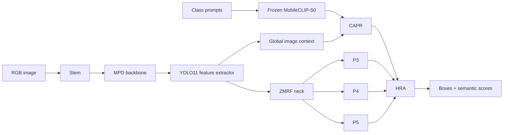

<div align="center">

# AeroSem-YOLO

**Semantic-guided and detail-preserving detection of drones and other airborne targets**

[](https://www.python.org/)
[](https://pytorch.org/)
[](LICENSE)


Language-conditioned detection built on YOLO11, with context-refined semantic
prototypes, detail-preserving downsampling, and zero-initialized multi-scale fusion.

</div>


## Highlights

- **CAPR** — refines frozen MobileCLIP class prototypes with image context through
  low-rank additive–multiplicative interaction and a gated residual update.
- **HRA** — aligns multi-level visual regions with refined semantic prototypes.
- **MPD** — preserves spatial detail during backbone downsampling with three
  complementary paths.
- **ZMRF** — exchanges adjacent-scale information through zero-initialized residual
  fusion in the neck.
- **Reproducible entry points** — portable commands for training, evaluation, and
  prompt-based inference; no machine-specific paths are embedded in the scripts.

## Architecture



The public paper names retain compatibility with the original implementation:

| Paper component | Implementation | Role |
| --- | --- | --- |
| CAPR | [`VCTETextAdapter`, `VCTEVisualAdapter`, `VCTETextEnhancer`](ultralytics/nn/modules/vcte.py) | Context-aware prototype refinement |
| HRA | [`VCTENeckModulator`](ultralytics/nn/modules/vcte.py) + [`YOLOVODetect`](ultralytics/nn/modules/head.py) | Hierarchical semantic modulation and region–text alignment |
| MPD | [`DRFD`](ultralytics/nn/extraction/logstem.py) | Multi-path detail-preserving downsampling |
| ZMRF | [`MCFGatedFusion`](ultralytics/nn/mm/mcf.py) | Zero-initialized multi-scale residual fusion |

Class names are intentionally preserved so existing checkpoints remain loadable.

## Repository layout

```text
AeroSem-YOLO/
├── configs/
│   └── models/
│       ├── aerosem-core.yaml          # semantic core without MPD/ZMRF
│       ├── aerosem-yolo.yaml          # full paper architecture
│       └── ablation/
│           ├── aerosem-mpd.yaml       # semantic core + MPD
│           └── aerosem-zmrf.yaml      # semantic core + ZMRF
├── scripts/
│   ├── download_mobileclip.py
│   ├── evaluate.py
│   ├── predict.py
│   ├── train.py
│   └── verify_install.py
├── ultralytics/                       # pinned research fork (base: 8.3.163)
├── LICENSE
├── THIRD_PARTY_NOTICES.md
└── pyproject.toml
```

Training runs, datasets, local logs, personal paths, archived source copies, and
large model weights are deliberately excluded.

## Installation

Python 3.10 or newer is recommended.

```bash
git clone <YOUR_REPOSITORY_URL>
cd AeroSem-YOLO
python -m venv .venv
```

Activate the environment, then install the project:

```bash
python -m pip install --upgrade pip
python -m pip install -e .
```

Download the MobileCLIP-S0 checkpoint from Apple's official host:

```bash
python scripts/download_mobileclip.py
python scripts/verify_install.py
```

The download helper prints the checkpoint SHA-256 after completion. Record that
value in the final release notes so other researchers can verify the same asset.
The MobileCLIP model weights are governed by Apple's model terms; see
[THIRD_PARTY_NOTICES.md](THIRD_PARTY_NOTICES.md).

## Data preparation

AeroSem-YOLO uses the standard Ultralytics detection layout:

```text
dataset/
├── images/
│   ├── train/
│   ├── val/
│   └── test/
├── labels/
│   ├── train/
│   ├── val/
│   └── test/
└── data.yaml
```

Example `data.yaml`:

```yaml
path: /absolute/path/to/dataset
train: images/train
val: images/val
test: images/test

names:
  0: airplane
  1: bird
  2: drone
  3: helicopter
```

Replace the example names with the exact class order used by your dataset and
checkpoints. Text prototypes are generated from these names, so spelling and class
order are part of the reproducibility contract.

## Training

Train the full AeroSem-YOLO architecture:

```bash
python scripts/train.py \
  --data /path/to/data.yaml \
  --model configs/models/aerosem-yolo.yaml \
  --epochs 300 \
  --imgsz 640 \
  --batch 32 \
  --device 0 \
  --seed 0
```

To initialize from a compatible YOLO11 checkpoint, add:

```bash
--weights /path/to/yolo11n.pt
```

The MobileCLIP text encoder is frozen by default (`--text-encoder-lr 0`). Set a
positive value only for a deliberate fine-tuning experiment.

Available architecture configurations:

| Configuration | CAPR/HRA | MPD | ZMRF |
| --- | :---: | :---: | :---: |
| `configs/models/aerosem-core.yaml` | ✓ | — | — |
| `configs/models/ablation/aerosem-mpd.yaml` | ✓ | ✓ | — |
| `configs/models/ablation/aerosem-zmrf.yaml` | ✓ | — | ✓ |
| `configs/models/aerosem-yolo.yaml` | ✓ | ✓ | ✓ |

## Evaluation

```bash
python scripts/evaluate.py \
  --weights /path/to/best.pt \
  --data /path/to/data.yaml \
  --split test \
  --imgsz 640 \
  --device 0
```

The evaluator uses the class names from `data.yaml` to rebuild the text cache before
metric collection. For cross-domain evaluation, keep the checkpoint fixed and pass
the target-domain dataset YAML.

## Inference

```bash
python scripts/predict.py \
  --weights /path/to/best.pt \
  --source /path/to/image_or_folder \
  --text drone bird airplane helicopter \
  --device 0
```

Predictions are saved under `runs/predict/` by default.

## Reproducibility contract

For every reported experiment, archive the following together:

1. model YAML and dataset YAML;
2. checkpoint SHA-256;
3. MobileCLIP checkpoint SHA-256;
4. exact class names and prompt text;
5. random seed, image size, batch size, epochs, and device type;
6. package lock or environment export;
7. raw validation output and per-class metrics.

The repository intentionally does not include datasets or paper checkpoints. Add
their public URLs, licenses, and checksums to the final release rather than placing
private local copies in Git.

## Scope and limitations

- The release currently targets object detection.
- Performance on extremely small or heavily blurred targets remains limited by the
  information available at the input resolution.
- Semantic priors cannot reconstruct spatial details absent from the image.
- Results may vary across CUDA, PyTorch, and GPU versions; report the full runtime
  environment for final paper numbers.
- HRA is represented by the original hierarchical modulation and region–text
  alignment implementation to preserve checkpoint compatibility.

## License

The AeroSem-YOLO code in this release is distributed under the
[GNU Affero General Public License v3.0](LICENSE), following the license of the
included Ultralytics fork. Third-party components and pretrained model assets retain
their own terms; see [THIRD_PARTY_NOTICES.md](THIRD_PARTY_NOTICES.md).

## Citation

The final BibTeX entry should be added after the paper title, author list, venue,
year, and DOI are finalized. Until then, cite the repository URL and the exact
release tag used in your experiment.

